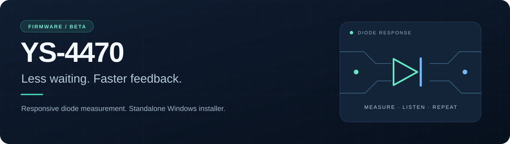

  

  
  
  

  <a href="#install">Quick start</a> · <a href="#how-the-speed-up-works">How it works</a> · <a href="#validation-and-remaining-work">Validation</a> · <a href="#magyarul">Magyarul</a>

# YS-4470 firmware improvements

## New beta: a breakthrough in diode responsiveness

**Near-instant diode measurement response and audible feedback — reported by the project owner on a physical YS-4470, with a significant improvement over earlier builds.** This is a practical breakthrough for the project's main goal: reducing the delay between probe contact and feedback. It is a qualitative hardware result, not a measured latency specification or a complete accuracy qualification.

**[Download the standalone Windows installer](https://github.com/NandorHU/YS4470-Firmware-RE/releases/download/installer-v2.0.0-beta.6-v2v4/YS4470-Installer-2.0.0-beta.6-v2v4.exe)** · [Release notes and checksums](https://github.com/NandorHU/YS4470-Firmware-RE/releases/tag/installer-v2.0.0-beta.6-v2v4)

The current release is **2.0.0-beta.6-v2v4**, a pre-release. Firmware is embedded in the EXE: **no separate factory firmware download, personal firmware input, Python setup or source build is needed to install it.**

| Faster feedback | Simple installation | Recovery built in |
|---|---|---|
| Owner-reported near-instant diode response and sound | One Windows EXE with embedded firmware | Verified automatic backup and full readback |

## Install

1. Download the EXE linked above and run it on Windows.
2. Connect one compatible YS-4470 in FEL mode using a USB data cable.
3. Choose **Install**. The installer checks the firmware family, confirms a full backup with two matching reads, writes only guarded application sectors, and verifies the complete flash readback.
4. Keep the automatic backup. The installer's restore function can restore it.

In diode mode, **Beta Diode** switches between **v2** and **v4**. The power-on default is **v2**. Choose USB driver setup only if device detection fails. An unrecognized firmware family is rejected.

## How the speed-up works

The changes target the measurement-command path and sound response. **They do not overclock the F1C100s system processor.** The builder changes application instructions, its overlay and the command descriptor table; it introduces no system-clock adjustment.

- **Less host-side waiting:** ownprotocol-style polling rearms the next measurement request sooner, with the existing idle, busy and mode guards.
- **A fixed-range request:** diode configuration sends `59 00` instead of `5a`. The interpretation as fixed range versus autorange follows reverse-engineered command usage; the measuring chip's internal algorithm is not documented here.
- **An additional measuring-chip command:** v2 and v4 send `68 0a` when configuring diode mode, derived from the factory Fast CONT path's `68 07`. This is the experimental "fast chip mode" change. It configures the measuring chip, rather than raising the main CPU clock. Its exact internal effect and each change's individual contribution have not been isolated by hardware measurements.
- **Earlier audible feedback in v4:** v4 adds "tone first" to v2. It starts a short tone at detected contact while the reading falls, then uses the reading trend to decide whether to sustain or stop it. A brief contact chirp is not proof that a diode is a short circuit or that a stable voltage measurement is already available.

| Profile | Behavior |
|---|---|
| v2 | Faster polling, fixed-range request and additional chip configuration; default after power-on |
| v4 | v2 plus early contact-tone logic |

Source and reproducible tests are on [the diode v2/v4 development branch](https://github.com/NandorHU/YS4470-Firmware-RE/tree/re/2026-11-20-diode-v2v4/contributions/COORD-ADC-CADENCE/vprofiles). That branch contains the beta's source; the root's older 1.0 builder is historical.

## Validation and remaining work

The release records ARM926 replays for profile selection, command dispatch, profile-change reconfiguration, synthetic reading decays and guards, plus simulated installer/update/restore tests and compiled Windows self-tests. The owner additionally reports substantially faster real-device operation, near-instant measurement response and sound. Emulation itself cannot establish analog behavior or physical latency.

Objective contact-to-sound and contact-to-stable-display timing, diode/LED range coverage, measurement accuracy and complete regression of other modes remain to be measured. Near-instant sound describes the owner's observed response, not a guaranteed millisecond value or an instantaneous stable reading. This is beta firmware, not a manufacturer-certified update.

## Project and historical work

This project reverse engineers and improves the YS-4470's existing firmware. The manufacturer's complete source code is unavailable. [Project status](PROJECT-STATUS.md), [changelog](CHANGELOG.md) and [provenance](NOTICE.md) provide context. Version 1.0, the offline patcher and the older Beta3-based build scripts remain historical developer tools; they are not prerequisites for the current installer.

Public files must not contain personal full-flash backups, calibration/device dumps, credentials or machine-specific workspace paths. Keep automatic backups and device logs private.

## Magyarul

**Az új béta a készülék tulajdonosának tesztje alapján jelentősen gyorsabb a korábbi verzióknál: a diódamérés reakciója és a hangvisszajelzés közel azonnali — ez áttörés a projektben.** A fenti EXE-t kell letölteni és elindítani; a firmware benne van, külön gyári firmware beszerzése nem szükséges. A Beta Diode gomb v2 és v4 között vált, bekapcsoláskor v2 aktív. A v4 a gyorsabb mérési konfiguráció mellett korai érintkezési hangot is ad. A hang kezdete nem jelenti, hogy a végleges mérési érték már beállt. A pontos késleltetés és a teljes mérési pontosság ellenőrzése még hátravan.
